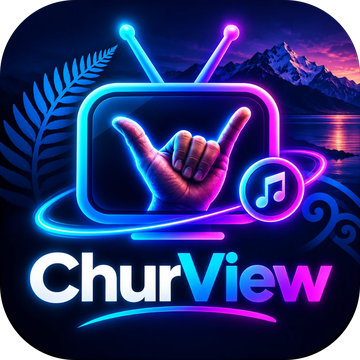
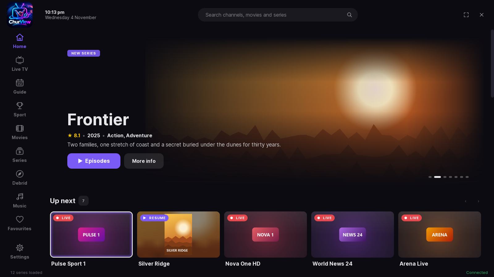
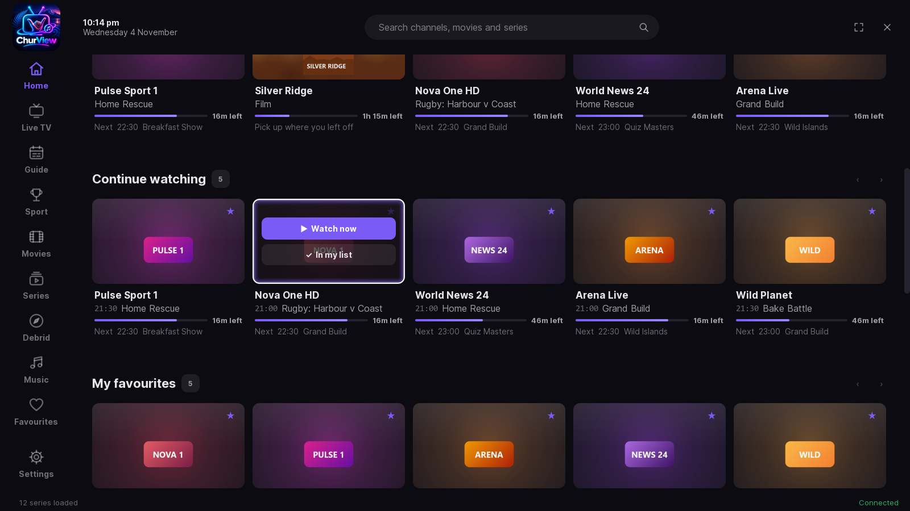
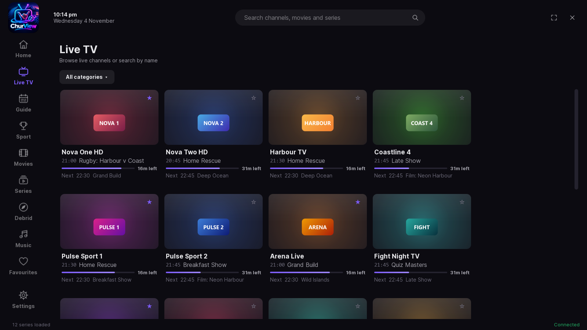
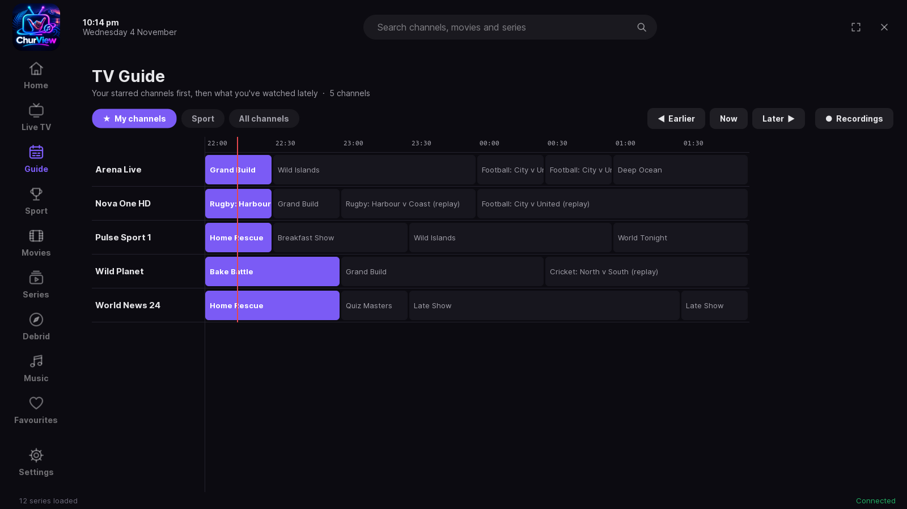
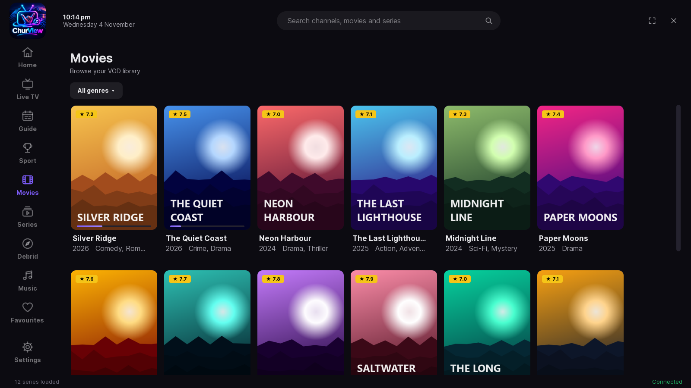
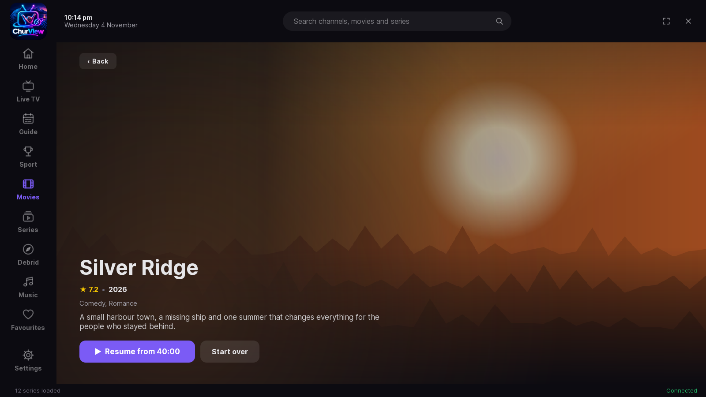

# ChurView

**A good-looking, easy TV player for your own IPTV subscription.**
Live TV, a proper TV guide, films and series, all in one place, on your PC, TV box or phone.

---

## What it does

**📺 Live TV that looks the part**
Every channel tile shows what's on now, how long is left and what's next. Each tile glows in the colour of its channel's logo.

**🗓️ A TV guide you'll actually use**
Your starred channels come first, followed by the ones you watch most. You can move earlier and later, set reminders, and watch catch-up when your provider offers it.

**🔁 Backup feeds, automatically**
If a channel stalls or keeps buffering, ChurView quietly switches to another copy of the same channel and moves back when the first one recovers.

**🎬 Films and series**
Big posters, ratings and plots, and you pick up where you left off. **Up next** puts the film you're halfway through, the episode you're on and your favourite channel that's on now all in one row.

**⏭️ Small things done right**
Skip intro and recap, night mode and clear dialogue for late viewing, subtitles when you want them, and a full-screen player that keeps out of the way.

**🧩 Your add-ons, your accounts**
Optional Stremio add-on support and Trakt watch-history sync, using your own accounts.

**👨‍👩‍👧 Family friendly**
Share your favourite channels with family on their own devices, set a parental PIN, and use it with a keyboard, mouse or TV remote.

---

## A look around

| Live TV | TV guide |
|---|---|
|  |  |
| **Films** | **Film page** |
|  |  |

*Screenshots use made-up demo channels and films.*

---

## Private and secure

- **Your login stays yours.** ChurView talks to your provider over a secure (https) connection whenever the provider supports one.
- **Locked on Android.** Saved logins and keys are locked with the device's own secure key store.
- **No tracking.** There are no adverts, no analytics and no accounts with us.
- **Safe support reports.** If you send one, it leaves out your logins, links and keys.

---

## Getting it

| | |
|---|---|
| **Android** (phones, Android TV, TV boxes) | Download the latest `ChurView-x.x.x.apk` from [**ChurView for Android**](https://github.com/Palmer890/churview-android/releases/latest) and install it. On a TV box, open the *Downloader* app and type the code **`2029447`**. |
| **Windows and Linux** | Already installed? ChurView keeps itself up to date from this page: check **Settings → Updates**. |

New versions go up as a **pre-release** first. Turn on **Settings → Updates → Try new updates first** if you'd like them early.

---

## Please note

ChurView is **a player only**. It comes with **no channels, films or subscriptions**: you sign in with your own provider, and you add your own add-ons if you want them. Only watch content you're allowed to watch.

Made with ☕ by a Kiwi. **Chur!** 🤙

